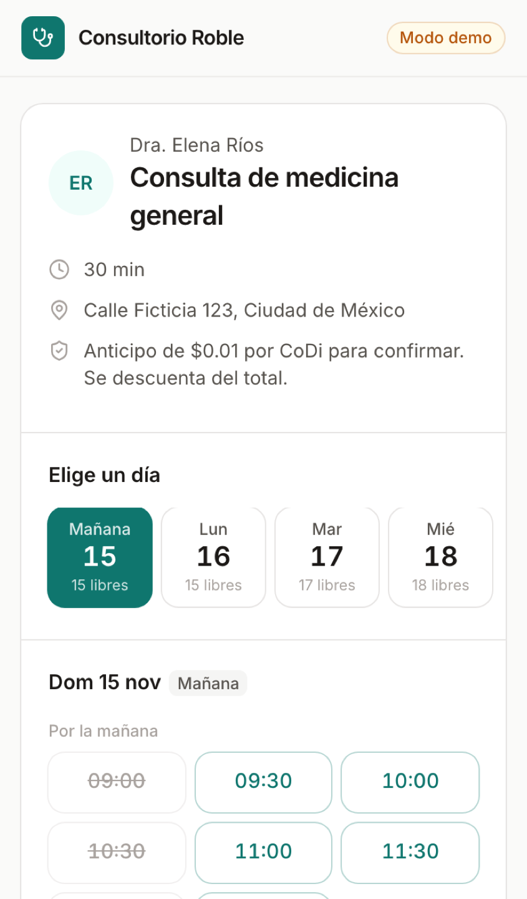
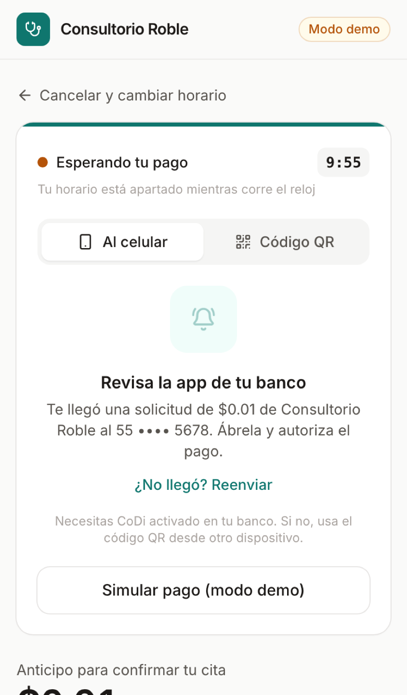
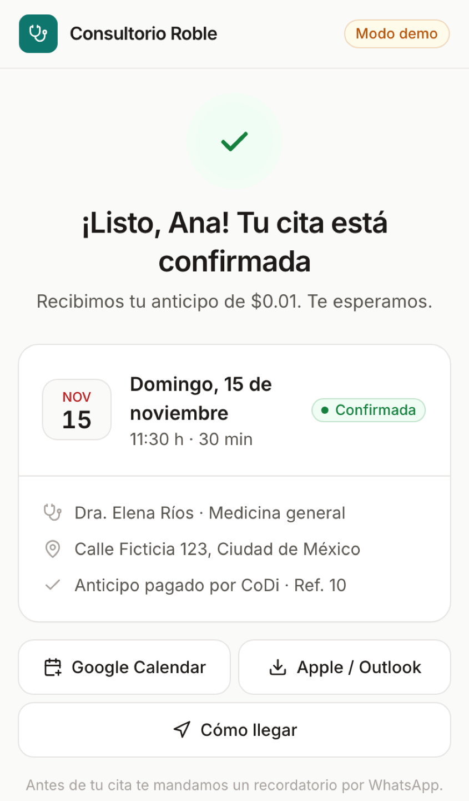
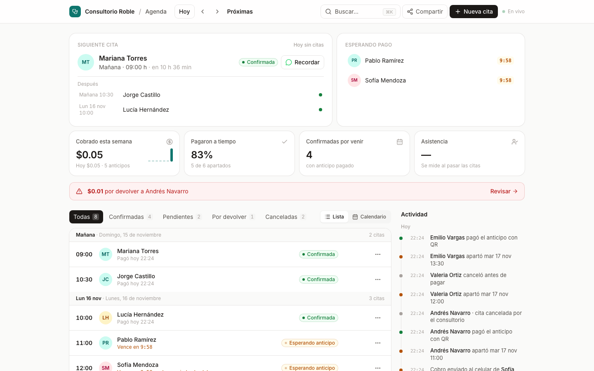
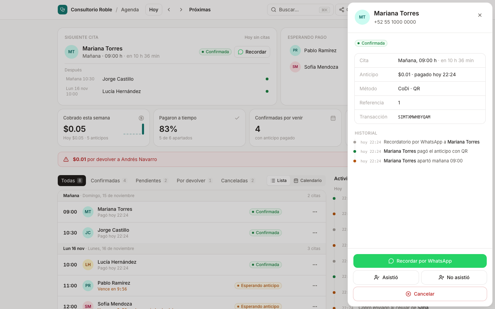

# Anticipo CoDi que confirma una cita

Proyecto para el Cursor Hackatón México 2026 (pey + CoDi). Un consultorio **ficticio** ("Consultorio Roble") abre su agenda; el paciente elige horario, se le aparta unos minutos y paga un anticipo con **CoDi** escaneando un QR generado con el API de [pey](https://docs.pey.mx). Cuando pey avisa del pago (webhook firmado), el servidor lo **verifica con pey** y la cita pasa sola de *esperando anticipo* a *confirmada*, en la pantalla del paciente y en la agenda del consultorio.

## Capturas

| Reservar (móvil) | Pago CoDi al celular | Confirmación |
|---|---|---|
|  |  |  |

Agenda del consultorio (escritorio): siguiente cita, pagos por vencer, métricas, acciones por fila y actividad.





## Flujo

1. `POST /api/citas` aparta el horario y llama a `POST https://api.pey.mx/codi/qr` (monto, concepto, `numRef`, vigencia ≥ 6 min).
2. El paciente paga escaneando el QR o, desde el celular, pidiendo el cobro directo a su app bancaria (`POST /codi/pn`).
3. pey manda `codi.qr.payment_received` o `codi.pn.payment_received` a `/api/webhooks/pey`; se valida la firma (Standard Webhooks) y se confirma con `GET /transaction/...` que el pago está `PAID`.
4. La cita queda **confirmada**. El mismo `transactionId` nunca se procesa dos veces.
5. Si el pago llega tarde: si el horario sigue libre, se confirma; si ya lo tomó otro paciente, queda **por devolver**. Igual con un pago duplicado o una cita pagada que se cancela.
6. El consultorio ve la agenda en vivo (lista o calendario), recuerda por WhatsApp, cobra al celular, marca asistencia, cancela y registra devoluciones.

## Correr en local

```bash
cp .env.example .env.local   # PEY_MODE=simulado por defecto
npm install
npm run dev                  # http://localhost:3000 (paciente) y /consultorio (agenda)
npm run prueba               # prueba de punta a punta con el servidor arriba
```

En modo `simulado` no se llama a pey: el botón *Simular pago* arma el mismo webhook que mandaría pey, lo firma y lo envía al endpoint real, así que se ejercita la verificación de firma y la idempotencia. Para cobrar de verdad: `PEY_MODE=real`, `PEY_API_KEY` y `PEY_WEBHOOK_SECRET` del portal de pey, y una URL pública registrada como webhook.

## Despliegue (Vercel)

Variables: `PEY_MODE=real`, `PEY_API_KEY`, `PEY_WEBHOOK_SECRET`, `ANTICIPO_MXN`. Para que el estado sobreviva entre funciones serverless, conectar **Upstash Redis** desde Vercel → Storage (inyecta `KV_REST_API_URL` y `KV_REST_API_TOKEN`); sin eso usa un archivo en `/tmp`, que solo sirve para pruebas.

## Componentes previos

Ninguno: todo el código se escribió durante el hackatón (desde el 14-nov-2026). Dependencias: Next.js, React, Tailwind CSS, lucide-react y `qrcode`.
